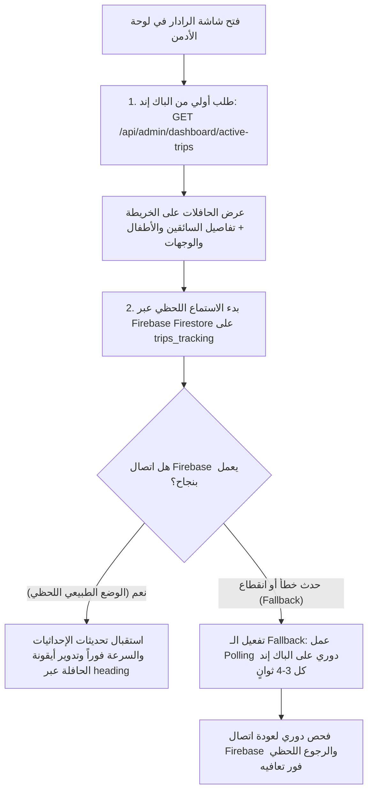

# 🛰️ دليل مطور الفرونت: ربط رادار الأدمن اللحظي بـ Firebase مع الـ Backend Fallback

مرحباً بك! هذا الدليل موجه خصيصاً لمطور الـ **Frontend (Web / Dashboard)**، ويشرح خطوة بخطوة وبالكود البرمجي الجاهز كيفية ربط **شاشة رادار الحافلات الحية (Live Radar)** بـ **Firebase Firestore** بالتوازي مع **الباك إند (Laravel Backend)** بنظام هجين ذكي (Hybrid Architecture) يضمن عمل الرادار بسلاسة مطلقة حتى لو انقطع اتصال الفايربيز أو تعذر الوصول إليه.

---

## 🎯 1. الفكرة العامة والمعمارية (Architecture Overview)

الرادار يعتمد نفس الآلية المتبعة في تطبيق ولي الأمر، ولكن على مستوى **أسطول الحافلات بالكامل**:



### لماذا هذا النظام الهجين؟
1. **السرعة وعدم إرهاق السيرفر:** الفايربيز يبث حركة الحافلة اللحظية في أجزاء من الثانية بمجرد أن يرسل السائق نبضة الـ GPS دون إرسال مئات طلبات HTTP إلى خادم الـ Laravel.
2. **البيانات الوصفية:** الفايربيز يحتوي فقط على التيليماتري الحية (إحداثيات، سرعة، زاوية اتجاه)، بينما الباك إند يحمل التفاصيل الكاملة (أسماء الطلاب، صور السائقين، أرقام الهواتف، المسارات، المحطات).
3. **الاعتمادية العالية (Fault Tolerance):** في حال حجب فايربيز، أو تعطل خوادم جوجل، أو مشاكل في الـ SDK، تتحول اللوحة تلقائياً إلى خادم الـ Backend وتظل الحافلات تتحرك بدون أي توقف!

---

## 📦 2. بنية البيانات في Firebase Firestore

* **اسم الـ Collection:** `trips_tracking`
* **معرّف الوثيقة (Document ID):** هو نفسه رقم الرحلة `trip_id` كنص (مثال: `"24"`).
* **شكل الوثيقة (Document Schema):**

```typescript
interface FirestoreTripTracking {
  trip_id: number;       // رقم الرحلة (يطابق ID الرحلة في الباك إند)
  driver_id: number;     // رقم السائق
  driver_lat: number;    // خط العرض الحالي (Latitude)
  driver_lng: number;    // خط الطول الحالي (Longitude)
  heading: number;       // زاوية اتجاه حركة الحافلة بالدرجات (0 إلى 360) لتدوير الماركر
  speed: number;         // سرعة الحافلة بالكيلومتر/الساعة (مثال: 55.4)
  status: string;        // 'active' أثناء الرحلة، أو 'completed' عند انتهائها
  is_online: boolean;    // true إذا كان السائق متصلاً ويرسل GPS، و false إذا أغلقت الرحلة
  updated_at: string;    // طابع زمني بصيغة ISO-8601 (مثال: "2026-10-11T09:30:00Z")
}
```

---

## 🔌 3. نقطة نهاية الباك إند (Backend Endpoint)

* **Method:** `GET`
* **URL:** `/api/admin/dashboard/active-trips`
* **Headers:**
  ```http
  Authorization: Bearer <ADMIN_TOKEN>
  Accept: application/json
  ```
* **شكل الرد من الباك إند:**

```json
{
  "success": true,
  "count": 1,
  "firebase": {
    "collection": "trips_tracking",
    "strategy": "realtime_with_backend_fallback"
  },
  "data": [
    {
      "id": 24,
      "trip_id": 24,
      "driver_id": 3,
      "name": "عبد السلام المصراتي",
      "phone": "0913456789",
      "avatar": "https://domain.com/storage/avatars/driver3.png",
      "children": "علي ومروة",
      "destination": "مدرسة الجيل الجديد الدولية",
      "duration": "12 دقيقة",
      "status": "في الطريق للاستلام",
      "lat": 32.910000,
      "lng": 13.170000,
      "heading": 135.0,
      "speed": "55 كم/س",
      "is_online": true,
      "firestore_doc": "trips_tracking/24",
      "map_x": 28.0,
      "map_y": 45.0,
      "region": "حي الأندلس",
      "last_update": "منذ دقيقتين"
    }
  ],
  "is_demo": false
}
```

---

## 💻 4. كود الربط الكامل الجاهز للإنتاج (Production-Ready Code)

يمكنك استخدام هذا الكلاس في أي بيئة (React, Vue, Angular, أو Vanilla JS):

### ملف: `services/AdminRadarManager.ts` (أو `.js`)

```typescript
import axios from 'axios';
import { initializeApp } from 'firebase/app';
import { 
  getFirestore, 
  collection, 
  query, 
  where, 
  onSnapshot, 
  Unsubscribe 
} from 'firebase/firestore';

// 1. إعدادات Firebase من الـ Environment
const firebaseConfig = {
  apiKey: process.env.VUE_APP_FIREBASE_API_KEY || process.env.REACT_APP_FIREBASE_API_KEY,
  authDomain: process.env.VUE_APP_FIREBASE_AUTH_DOMAIN || process.env.REACT_APP_FIREBASE_AUTH_DOMAIN,
  projectId: process.env.VUE_APP_FIREBASE_PROJECT_ID || process.env.REACT_APP_FIREBASE_PROJECT_ID,
  storageBucket: process.env.VUE_APP_FIREBASE_STORAGE_BUCKET,
  messagingSenderId: process.env.VUE_APP_FIREBASE_MESSAGING_SENDER_ID,
  appId: process.env.VUE_APP_FIREBASE_APP_ID
};

const app = initializeApp(firebaseConfig);
const db = getFirestore(app);

export interface RadarTrip {
  id: number;
  trip_id: number;
  driver_id: number;
  name: string;
  phone: string;
  avatar: string;
  children: string;
  destination: string;
  duration: string;
  status: string;
  lat: number;
  lng: number;
  heading?: number;
  speed?: string | number;
  is_online?: boolean;
  firestore_doc?: string;
  region?: string;
  last_update?: string;
}

export type RadarDataSource = 'firebase' | 'backend_fallback';

export class AdminRadarManager {
  private tripsMap: Map<number, RadarTrip> = new Map();
  private unsubscribeFirestore: Unsubscribe | null = null;
  private fallbackInterval: any = null;
  private currentSource: RadarDataSource = 'firebase';
  private onUpdateCallback: ((trips: RadarTrip[], source: RadarDataSource) => void) | null = null;
  private apiToken: string;
  private backendUrl: string;

  constructor(apiToken: string, backendUrl: string = '/api/admin/dashboard/active-trips') {
    this.apiToken = apiToken;
    this.backendUrl = backendUrl;
  }

  /**
   * تشغيل الرادار: جلب أولي من الباك إند + بدء الاستماع للفايربيز
   */
  public async start(onUpdate: (trips: RadarTrip[], source: RadarDataSource) => void) {
    this.onUpdateCallback = onUpdate;

    try {
      // الخطوة 1: جلب البيانات الأولية من الباك إند
      await this.fetchInitialDataFromBackend();
    } catch (err) {
      console.warn('⚠️ فشل الجلب الأولي من الباك إند، المتابعة للاستماع للفايربيز...', err);
    }

    // الخطوة 2: بدء الاستماع اللحظي للفايربيز
    this.subscribeToFirebase();
  }

  /**
   * إيقاف الرادار وإلغاء الاشتراكات لتجنب تسريب الذاكرة (Memory Leaks)
   */
  public stop() {
    if (this.unsubscribeFirestore) {
      this.unsubscribeFirestore();
      this.unsubscribeFirestore = null;
    }
    this.stopFallbackPolling();
  }

  /**
   * 1. الجلب من الباك إند
   */
  private async fetchInitialDataFromBackend() {
    const response = await axios.get(this.backendUrl, {
      headers: {
        Authorization: `Bearer ${this.apiToken}`,
        Accept: 'application/json',
      },
    });

    if (response.data && response.data.data) {
      const tripsList: RadarTrip[] = response.data.data;
      tripsList.forEach((trip) => {
        this.tripsMap.set(trip.id, trip);
      });
      this.notifySubscribers();
    }
  }

  /**
   * 2. الاستماع اللحظي عبر Firebase Firestore
   */
  private subscribeToFirebase() {
    try {
      const tripsTrackingRef = collection(db, 'trips_tracking');
      // الاستماع لكافة الرحلات النشطة
      const q = query(tripsTrackingRef, where('status', '==', 'active'));

      this.unsubscribeFirestore = onSnapshot(
        q,
        (snapshot) => {
          // نجح الاتصال بالفايربيز -> نوقف الـ Fallback إذا كان مفعلاً
          if (this.currentSource !== 'firebase') {
            console.log('✅ تم استعادة اتصال Firebase! إيقاف الـ Backend Polling.');
            this.stopFallbackPolling();
            this.currentSource = 'firebase';
          }

          snapshot.docChanges().forEach((change) => {
            const data = change.doc.data();
            const tripId = Number(data.trip_id);

            if (change.type === 'added' || change.type === 'modified') {
              this.updateTripTelemetry(tripId, {
                lat: Number(data.driver_lat),
                lng: Number(data.driver_lng),
                heading: Number(data.heading || 0),
                speed: typeof data.speed === 'number' ? `${Math.round(data.speed)} كم/س` : data.speed,
                is_online: Boolean(data.is_online),
                last_update: 'الآن (مباشر)',
              });
            } else if (change.type === 'removed') {
              // إذا انتهت الرحلة وأزيلت من active
              this.tripsMap.delete(tripId);
            }
          });

          this.notifySubscribers();
        },
        (error) => {
          // ⚠️ حدث خطأ في اتصال الفايربيز -> تفعيل الـ Fallback فوراً
          console.warn('🚨 انقطع اتصال Firebase، التحول التلقائي للـ Backend Fallback...', error);
          this.activateFallbackPolling();
        }
      );
    } catch (err) {
      console.error('🚨 تعذر تهيئة Firebase SDK، التحول للـ Fallback:', err);
      this.activateFallbackPolling();
    }
  }

  /**
   * تحديث الإحداثيات والتيليماتري لرحلة معينة مع الحفاظ على بيانات السائق والوجهة
   */
  private updateTripTelemetry(tripId: number, telemetry: Partial<RadarTrip>) {
    const existing = this.tripsMap.get(tripId);
    if (existing) {
      this.tripsMap.set(tripId, {
        ...existing,
        ...telemetry,
      });
    } else {
      // إذا كانت رحلة جديدة بدأت لتوها ولم تكن في التحميل الأولي، نطلب تحديثاً من الباك إند
      this.fetchInitialDataFromBackend();
    }
  }

  /**
   * 3. تفعيل الـ Backend Polling Fallback (كل 3.5 ثوانٍ)
   */
  private activateFallbackPolling() {
    if (this.fallbackInterval) return; // شغال بالفعل

    this.currentSource = 'backend_fallback';
    this.notifySubscribers();

    this.fallbackInterval = setInterval(async () => {
      try {
        await this.fetchInitialDataFromBackend();
      } catch (err) {
        console.error('فشل جلب الـ Fallback من الباك إند أيضاً:', err);
      }
    }, 3500);
  }

  private stopFallbackPolling() {
    if (this.fallbackInterval) {
      clearInterval(this.fallbackInterval);
      this.fallbackInterval = null;
    }
  }

  private notifySubscribers() {
    if (this.onUpdateCallback) {
      const tripsArray = Array.from(this.tripsMap.values());
      this.onUpdateCallback(tripsArray, this.currentSource);
    }
  }
}
```

---

## 🎨 5. مثال تطبيق React (Custom Hook + الخريطة)

### ملف: `hooks/useAdminRadar.ts`
```typescript
import { useState, useEffect } from 'react';
import { AdminRadarManager, RadarTrip, RadarDataSource } from '../services/AdminRadarManager';

export function useAdminRadar(adminToken: string) {
  const [trips, setTrips] = useState<RadarTrip[]>([]);
  const [source, setSource] = useState<RadarDataSource>('firebase');
  const [loading, setLoading] = useState<boolean>(true);

  useEffect(() => {
    if (!adminToken) return;

    const radarManager = new AdminRadarManager(adminToken);

    radarManager.start((updatedTrips, currentSource) => {
      setTrips(updatedTrips);
      setSource(currentSource);
      setLoading(false);
    });

    return () => {
      radarManager.stop();
    };
  }, [adminToken]);

  return { trips, source, loading };
}
```

### استخدامها في واجهة لوحة الأدمن:
```tsx
import React from 'react';
import { useAdminRadar } from './hooks/useAdminRadar';

export function RadarDashboardPage() {
  const token = localStorage.getItem('admin_token') || '';
  const { trips, source, loading } = useAdminRadar(token);

  return (
    <div className="radar-page">
      {/* شريط حالة الاتصال الحي */}
      <div className="status-bar flex justify-between p-4 bg-gray-900 text-white">
        <h2>رادار أسطول الحافلات النشط ({trips.length} حافلة)</h2>
        <div>
          {source === 'firebase' ? (
            <span className="text-green-400 font-bold flex items-center gap-2">
              <span className="w-3 h-3 bg-green-500 rounded-full animate-ping"></span>
              بث مباشر لحظي (Firebase Live)
            </span>
          ) : (
            <span className="text-yellow-400 font-bold flex items-center gap-2">
              <span className="w-3 h-3 bg-yellow-500 rounded-full"></span>
              وضع النسخ الاحتياطي (Backend Fallback Polling)
            </span>
          )}
        </div>
      </div>

      {/* الخريطة وعرض الحافلات */}
      <div id="radar-map" className="w-full h-[600px]">
        {/* يمكنك تمرير trips إلى Leaflet أو Google Maps */}
        {trips.map((trip) => (
          <div key={trip.id} className="trip-card">
            <h4>{trip.name} (حافلة #{trip.id})</h4>
            <p>السرعة: {trip.speed}</p>
            <p>الاتجاه: {trip.heading}°</p>
            <p>الحالة: {trip.is_online ? 'متصل' : 'غير متصل'}</p>
          </div>
        ))}
      </div>
    </div>
  );
}
```

---

## 🗺️ 6. تحريك وتدوير أيقونة الحافلة على الخريطة (Leaflet / Google Maps)

لإعطاء تجربة مستخدم مبهرة في لوحة التحكم:
1. **تدوير الأيقونة حسب الاتجاه (`heading`):**
   ```css
   .bus-marker-icon {
     transition: transform 0.8s ease-in-out, top 0.8s linear, left 0.8s linear;
   }
   ```
   وعند تحديث الماركر:
   ```javascript
   markerElement.style.transform = `rotate(${trip.heading}deg)`;
   ```
2. **تحديث موقع الماركر بسلاسة (Smooth Animation):**
   عند وصول نبضة جديدة من الفايربيز، لا تقم بحذف وإعادة رسم الماركر! بدلاً من ذلك، قم بتحديث إحداثيات الماركر القائم:
   ```javascript
   // Leaflet:
   marker.setLatLng([trip.lat, trip.lng]);

   // Google Maps:
   marker.setPosition(new google.maps.LatLng(trip.lat, trip.lng));
   ```

---

## 🧪 7. كيف تختبر الرادار والـ Fallback بنفسك؟

1. **لاختبار الحركة الحية عبر الفايربيز:**
   قم بتشغيل أمر المحاكاة في السيرفر:
   ```bash
   php artisan trip:radar-simulate --interval=2
   ```
   ستلاحظ في واجهة الفرونت أن الحافلات تتحرك وتتغير سرعتها وزاوية اتجاهها كل ثانيتين مباشرة من الفايربيز ومؤشر الاتصال يُظهر: `Firebase Live`.
2. **لاختبار الـ Fallback عند تعطل الفايربيز:**
   * في الـ DevTools (Network Tab) بالمتصفح، قم بحظر النطاق `firestore.googleapis.com` (Block Request Domain).
   * ستلاحظ أن لوحة الأدمن انتقلت فوراً وبدون أي انقطاع إلى: `Backend Fallback Polling`، وظلت إحداثيات وسرعة الحافلات تتحدث عبر مسار `/api/admin/dashboard/active-trips`.
   * بمجرد إزالة الحظر، ستعود اللوحة تلقائياً للبث المباشر `Firebase Live`!

---
جاهز تماماً للربط والتشغيل في الواجهة! إذا احتجت لأي تعديل أو مكتبة خريطة معينة (Leaflet, Mapbox, Google Maps)، أخبرني فوراً.
